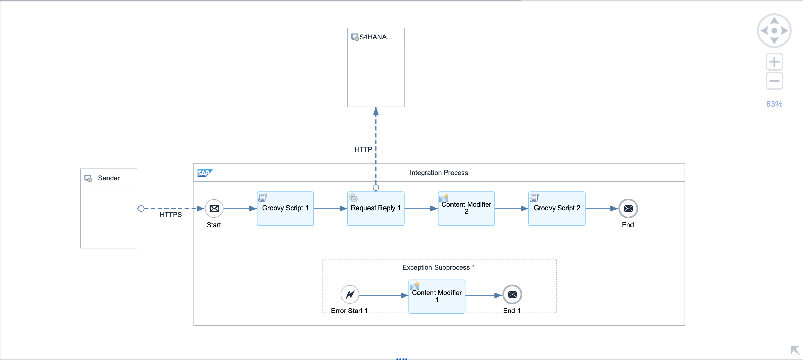
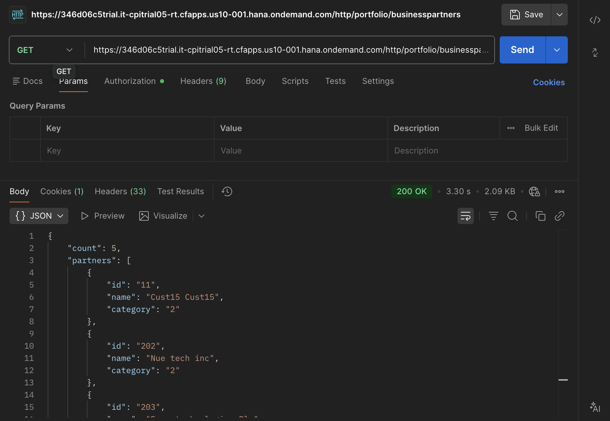
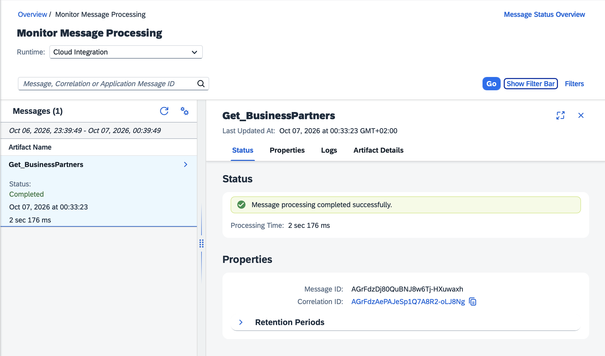

# SAP CPI – S/4HANA Business Partner Integration

An integration flow on **SAP Integration Suite (Cloud Integration / CPI)** that exposes a secured HTTPS endpoint, reads Business Partner master data from the **SAP S/4HANA Cloud sandbox API** (OData V2), and returns a simplified JSON list to the caller.

Built on an SAP BTP trial account as a portfolio project. The backend is SAP's public sandbox system from the SAP Business Accelerator Hub, so all data shown here is SAP demo data.

## Scenario

A non-SAP client application needs a short list of business partners from S/4HANA. It should not have to know the OData service, handle the S/4HANA API key, or parse a large OData response.

| Role | System |
|---|---|
| Sender (non-SAP) | Postman, standing in for an external application |
| Middleware | SAP Integration Suite – Cloud Integration |
| Receiver (SAP) | SAP S/4HANA Cloud sandbox – `API_BUSINESS_PARTNER` (Business Partner A2X, OData V2) |

## Architecture

```
Postman ──HTTPS + OAuth 2.0──▶ iFlow: Get_BusinessPartners ──HTTP + API key──▶ S/4HANA Cloud sandbox
        ◀──── simplified JSON ────                          ◀──── OData V2 JSON ────
```



## How it works

| # | Step in the diagram | Type | What it does |
|---|---|---|---|
| 1 | Sender → Start | HTTPS adapter | Exposes `/http/portfolio/businesspartners`. Callers need the role `ESBMessaging.send`. |
| 2 | Set API Key | Groovy script (`setApiKey.groovy`) | Reads the sandbox API key from the secure store and sets the `APIKey` and `Accept` headers. |
| 3 | Request Reply 1 | Request-Reply, HTTP adapter | Sends `GET /A_BusinessPartner` with `$top=5` and `$select` to fetch only the three required fields. |
| 4 | Content Modifier 2 | Content Modifier | Deletes the `APIKey` header so the key is not returned to the caller. |
| 5 | Format Response | Groovy script (`formatResponse.groovy`) | Maps the OData response to a compact JSON structure with a record count. |
| 6 | Exception Subprocess 1 | Content Modifier 1 | Returns a JSON error message if any step fails. |

### Request to S/4HANA

```
GET https://sandbox.api.sap.com/s4hanacloud/sap/opu/odata/sap/API_BUSINESS_PARTNER/A_BusinessPartner
    ?$top=5&$select=BusinessPartner,BusinessPartnerFullName,BusinessPartnerCategory
```

Using `$select` reduces the response from about 80 fields per partner to the 3 that are needed.

### Response returned to the caller

```json
{
    "count": 5,
    "partners": [
        { "id": "11",   "name": "Cust15 Cust15",           "category": "2" },
        { "id": "202",  "name": "Nue tech inc",            "category": "2" },
        { "id": "203",  "name": "Expo technologies Plc",   "category": "2" },
        { "id": "1018", "name": "Bechtle AG Kriek street", "category": "2" },
        { "id": "1710", "name": "Inlandskunde DE 80",      "category": "2" }
    ]
}
```

Category `2` is an organization; `1` would be a person.



## Security design

- **Inbound:** the endpoint is protected with OAuth 2.0 client credentials. The client is a service key of a *Process Integration Runtime* instance (plan `integration-flow`) with the role `ESBMessaging.send`.
- **Outbound:** the S/4HANA API key is stored as a **Secure Parameter** (`S4_SANDBOX_APIKEY`) in the tenant's security material. It is never written into the iFlow, the scripts or this repository.
- **Key lifetime in the message:** the key is set as a header only for the outbound call and deleted in the next step.
- **No secrets in logs:** the iFlow runs at the default log level, where header values are not recorded.

### Known limitation

The sandbox only accepts the key as an HTTP header, and the HTTP adapter has no built-in API-key authentication, so a script has to place the key in a header for the duration of the call. Cloud Integration flags this with a design guideline warning. A stronger design is to put **SAP API Management** in front of the backend and let a policy inject the key, so it never enters the iFlow at all.

## Error handling

An Exception Subprocess catches any failure in the flow (for example the sandbox being unavailable or the secure parameter missing) and returns:

```json
{"error": "Business Partner service unavailable"}
```

The failed message remains visible in *Monitor Message Processing* with the full error for analysis.



## Repository contents

| Path | Content |
|---|---|
| `Get_BusinessPartners.zip` | Exported integration flow, ready to import |
| `scripts/setApiKey.groovy` | Reads the API key from the secure store |
| `scripts/formatResponse.groovy` | Maps the OData response to the output JSON |
| `screenshots/` | iFlow diagram, Postman response, message monitoring |

## How to run it

1. **Get an API key.** Log in at [api.sap.com](https://api.sap.com), open *Business Partner (A2X)* for SAP S/4HANA Cloud Public Edition, and choose *Show API Key*.
2. **Store the key.** In Integration Suite: *Monitor → Integrations and APIs → Security Material → Create → Secure Parameter*, name `S4_SANDBOX_APIKEY`, then deploy.
3. **Import the iFlow.** In a package: *Artifacts → Add → Integration Flow → Upload*, select `Get_BusinessPartners.zip`, then deploy.
4. **Create client credentials.** In the BTP subaccount, create a *Process Integration Runtime* instance (plan `integration-flow`, role `ESBMessaging.send`) and a service key.
5. **Call the endpoint.** Send a `GET` to `https://<runtime-host>/http/portfolio/businesspartners` using OAuth 2.0 client credentials with the `clientid`, `clientsecret` and `tokenurl` from the service key.

## Technologies

SAP Integration Suite (Cloud Integration) · SAP BTP · SAP S/4HANA Cloud OData V2 API · Groovy · OAuth 2.0 · HTTPS / HTTP adapters

## Possible extensions

- Accept `$top` and a name filter as query parameters from the caller.
- Send an email alert from the Exception Subprocess using the Mail adapter.
- Replace the HTTP adapter with the OData adapter and its query editor.
- Front the backend with SAP API Management for key injection, rate limiting and threat protection.

## Author

Sai Uday Bhaskar Pappu – SAP Integration Developer (SAP Integration Suite / CPI), MSc Cybersecurity
